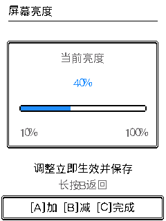

# 默认声音与屏幕亮度调整

## 线上核对

2026-10-29 查询官方发布接口：PokeWalk 项目 234 的公开版本为已审核 REV-3784，对应 GitHub `v2026.10.26-bug-survey`。两处完整包 SHA-256 均为 `8b49d5151a9d5f46021218682faef745444e6e9dad27354a5cb9e21098c215f1`；应用为 `825c2b28cbce6259738f105eb5baa99bf1a8f710d29cda8515a752c368f74ba7`，与上轮已验证构建一致。

该公开构建没有启用 `CONFIG_POKEWALK_SILENT_BOOT`，仍能通过设置开启声音。但 `audio_settings_init()` 在缺少 `mute` 设置时默认静音，因此全新安装确实无声；这是早期已有的运行时默认值。上轮为真机测试保存的静音选择也会随保档更新继续保留，不能把两者混为编译时永久禁声。

原版本已提供亮度设置，位置为「菜单 → 选项」第八项，范围 10%–100%。原先确认后仍停留在选项列表，仅底部按键提示变化，不容易看出已开始调节。

核对记录：[公开版本](evidence/audio-brightness-2026-10-29/public-check.json)、[GitHub 清单](evidence/audio-brightness-2026-10-29/public-manifest.json)。

## 本次改动

- 缺少声音设置时默认开启声音，音量仍为 55%。已有合法的静音开关及音量原样保留；读取错误或损坏值仍保持安静，不写回覆盖旧设置。读取设置前的启动静音保护不变。
- 亮度菜单改为「屏幕亮度」，按 C 进入独立画面，显示百分比、亮度条和范围。A 加 10%、B 减 10%，限制在 10%–100%；每次调整立即保存并生效，C 完成或长按 B 返回。
- 保存失败不改变实际亮度，画面提示重试；长按 C 熄屏、唤醒恢复原亮度，唤醒按键不会顺带完成调整。
- 预览采用相同的声音默认值；浏览器的「开启试听」仍由用户操作。补齐自动化检查并加入 CI；静音专用测试显式设置静音，不再依赖新安装默认值。

## 兼容、资源与验证

存档仍为逻辑 V32 / 格式 4，世界记录、历史固定样本、NVS 键、分区与 USB 协议不变。保留原 `mute`、`volume`、`brightness`、`battery_show` 键；导入旧备份时这些已有设置继续生效。本次没有修改在线或离线备份工具。

13 项本地检查通过，清单与源码摘要见 [验证记录](evidence/audio-brightness-2026-10-29/verification.json)：

- 生产声音设置代码覆盖全新命名空间、缺失键、已有静音/有声、重启、0 音量、非法值和各阶段 NVS 失败。生产菜单覆盖 C 确认、静音 PCM 门控、音量调整不解除静音以及熄屏唤醒。
- 亮度页完成 76 次按键与横带/完整重画比较，覆盖上下限、保存失败、再次打开和唤醒。基础页面完成 1,312 次重画一致性检查。声音切换使用实际声音任务与混音器；旧运行时静音脚本补齐 ES8311 休眠依赖和当前队列等待适配后通过。
- V5–V32 固定历史样本迁移通过。隔离的真实 ESP-IDF NVS 引擎完成旧档导入、设置恢复、759 个体及稠密技能策略、300 次连续保存和 185 个中断点回归；这些是宿主验证，不是真机覆盖导入。
- ESP32-C3 构建通过，应用 3,229,696 B，比线上增加 416 B，应用分区余量 178,176 B。主 DRAM `.data` / `.bss` 与基线相同（14,060 / 171,160 B），无新增常驻缓存或堆分配。菜单目标编译器最大单函数栈帧 192 B；RTC 余量 328 B，IRAM 79,360 B，原音频 DMA IRAM 配置保留。见 [构建摘要](evidence/audio-brightness-2026-10-29/build-summary.json) 与 [栈检查](evidence/audio-brightness-2026-10-29/verify_save_stack.py.txt)。

本轮未烧录、未发布。新亮度页未做真机亮度/按键耗时验收，新安装有声后的 Wi-Fi 堆余量与扬声器听感也未在设备重测；静态预算与宿主模拟不代表这些真机项目已经通过。后续烧录或发布仍需按 AGENTS.md 执行对应验收，并保留用户当前静音选择及进度。

2026-10-29 后续已按用户要求完成真机烧录与备份覆盖恢复；上文“未烧录、未发布”是初步实现阶段状态。最终范围及发布回执见 [本次发布记录](audio-brightness-release-2026-10-29.md)。
