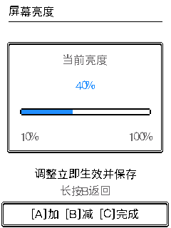
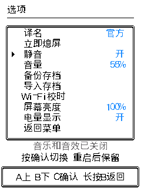

# 声音默认值与亮度调节发布记录 · 2026-10-29

本次修复新安装默认无声的问题，并把「屏幕亮度」改为独立调节页。已有合法静音和音量选择继续保留；设置读取失败仍保持安静。亮度范围 10%–100%，A/B 每次调整 10%，立即保存，C 完成或长按 B 返回。功能背景和初步检查见 [实现记录](audio-brightness-2026-10-29.md)，用户说明见 [更新日志](../docs/release/2026-10-29-audio-brightness/changelog.zh.md)。

## 兼容与发布检查

逻辑存档仍为 V32 / 39,976 B，USB 容器仍为格式 4 / 72 KiB。没有修改持久化结构、编号、分区、NVS 键或 USB 协议；仍支持同设备 V5–V32 的旧备份。原有静音、音量、亮度和电量显示设置由原键保存，不把“新安装默认有声”覆盖到已有设置。

[61 项本地发布检查](evidence/audio-brightness-release-2026-10-29/checks.json) 全部通过，另完成 ESP32-C3 构建与目标栈检查。范围包括 V5–V32 固定样本、隔离真实 NVS 的 759 个体及稠密技能策略、连续保存/故障回滚、USB 分阶段失败、动画时序、捕获、声音及新增设置页面。官网 664 页面变体、两版目录来源、在线/离线分发检查通过。

新行为需要更新固件；刷新官网只更新攻略。支持格式 4 的旧离线备份工具继续可用，本次 ZIP 更新的是配套攻略。已有设备优先使用 USB 保档更新包；社区完整安装包含 NVS 空白填充，会覆盖原数据，必须先备份、安装后导入。devbox 按用户先前“先完成 GitHub 和社区发布”的指示暂缓，本次不宣称已同步。

## 真机验证

设备为 ESP32-C3 / FoloToy AI Passport，实际存档含 125 个伙伴。旧应用前缀与上一公开版 `825c2b28cbce6259738f105eb5baa99bf1a8f710d29cda8515a752c368f74ba7` 完全一致。烧录前建立并回读校验 `.pksave`，同时备份应用和受保护 Flash 范围；写入后应用核验通过，所有保护范围逐字节不变，分区表未修改。

- 实机完成亮度 100%→40%→10%→100%、再次进入及保存检查；立即熄屏后 PWM 为 0，唤醒恢复 40%。诊断中的 39/9 是硬件 PWM 整数换算，设置页分别为 40%/10%。
- 升级前备份跨构建导入：先持久化亮度 40%，使用生产网页接收器和文件解码器完成预备份落盘/回读/ACK、576 块上传与重启，收到与本次载荷匹配的成功回执；亮度回到 100%。
- 新版备份往返：先导出，再改亮度为 40%、音量为 0、关闭静音，让实际混音/I2S 通道和 Wi-Fi 扫描同时运行；随后导入新备份，收到匹配成功回执。最终静音开启、音量 55%、亮度 100%，保持玩家原选择。
- 再次导出，用实际 `save_decode` 比较伙伴/仓库个体及技能策略、等级/经验、图鉴、遭遇、道具、成就、挑战、秘境、城都活动/故事、地区与雷达/漫游状态，均一致。自然经过时间和养成衰减不作为逐字节相等条件。

[真机验收](evidence/audio-brightness-release-2026-10-29/device-acceptance.json) · [最终语义比对](evidence/audio-brightness-release-2026-10-29/save-comparison.txt)

第一遍跨版本导入已恢复设置，但诊断脚本在暂存后关闭、重新打开串口，触发额外 USB 重置，未捕获第一次启动的回执。改为保持同一串口连接跨越重启后，重新执行旧版和新版导入，二者都取得匹配回执；不把第一次缺少回执算作通过。帧率采样后的测试脚本还发生一次光标导航错误，进入遭遇页；随后恢复原备份并完成上述最终比对。没有修改游戏逻辑来迁就测试脚本。

## 性能、音频与资源

在同一设备、125 个体、亮度 100%、持久化静音和 Wi-Fi 扫描条件下对比上一公开版与候选。完整重绘三次的中位数：选项页 40.422→40.635 ms，亮度选中行 40.256→40.470 ms，均约增加 0.53%；亮度新编辑页约 37.159 ms（无旧版同页面基线）。

照料、队伍、待机各观察 10 秒。照料/队伍回调 P95 桶上界保持 88 ms，待机完成帧间隔 P95 保持 256 ms；每个呈现帧平均绘制耗时分别约 18.73→19.08、11.23→11.18、27.59→27.72 ms。照料/队伍包含设计上的动作间停顿，`4294967295` 仅表示超过 504 ms 的直方图桶，不能当作精确毫秒数或换算成掉帧。没有改动画速度或 LCD 目标刷新周期。

[原始脱敏采样与对照](evidence/audio-brightness-release-2026-10-29/device-performance.json)

静音正常运行最大连续堆块为 18,432 B，测得最低堆约 18,996 B。音频实际运行、音量 0 时，正常页面最低堆 9,992 B，最大连续块 9,728 B；Wi-Fi 扫描后的导入阶段最低堆 9,640 B，最大连续块 9,216 B，真实上传/校验/恢复通过。UI 定时器/LVGL 栈余量为 3,544/4,924 B，音频任务约 1,988 B，导入时调试任务约 1,764 B。静态 DRAM、RTC codec 和现有 DMA 缓冲区未扩张。

音频供数错误计数为 0，零音量页面测试最长供数间隔 36.231 ms；SDK 在既有“启用前先关闭”防御流程中打印了已关闭 I2S 通道的日志，代码明确容忍 `ESP_ERR_INVALID_STATE`，随后开启和写入成功。不能把音频计数当作扬声器实听结果。为保留安静测试，本轮没有实听，也没有重测所有战斗/捕获动画、物理长按 C 或真机满仓；这些对应的宿主检查通过不等于全部真机覆盖。

## 固件与素材

已验收应用来自源码 `7e0a4f2d124016bfcb87fd12fad9c4a8f7aeed7a`，后续仅修正攻略标签，没有改变固件来源文件。应用 3,229,696 B，SHA-256 `74538aa9901866c1c61643032ab5d3b53cda896af5b78dded49eeba5f5cf106b`；应用分区余量 178,176 B。完整包 3,295,232 B，SHA-256 `a3b1c5177340959d2eeebebba53b37f77205e6097237c0d9191aa8929119c499`，小于 8 MiB。官方打包校验及项目保护区检查通过；完整包与 USB 更新 ZIP 中的应用均与真机验收文件逐字节相同。

[固定发布文件摘要](evidence/audio-brightness-release-2026-10-29/package.json)。沿用用户选定的皮卡丘对战暴鲤龙封面，以及雷达、漫游、赤红、照料四张原附图。私人备份、设备身份、原始 Flash 和含附近 Wi-Fi 的串口日志均只留在忽略目录。

## 发布状态

- [PR #6](https://github.com/Luobata/ESP32-PokemonGo/pull/6) 已合并至 main，合并提交 `c7eab742e8178ca1f961661ae294918ede940573`，文件树与验收分支 `01d3111eec1b1a8ec7941ea9759e323e834b2ecf` 一致。[最终 PR CI](https://github.com/Luobata/ESP32-PokemonGo/actions/runs/40815563924) 全部通过；main 相同文件树自动触发的重复 CI 在本记录快照时仍运行，不把未结束的重复运行算作通过。[合并回执](evidence/audio-brightness-release-2026-10-29/merge.json) · [CI](evidence/audio-brightness-release-2026-10-29/ci-pr.json)。
- [GitHub v2026.10.29-audio-brightness](https://github.com/Luobata/ESP32-PokemonGo/releases/tag/v2026.10.29-audio-brightness) 已公开并设为 Latest，标签指向上述合并提交。四个发布附件已下载回读，与固定文件逐字节一致。[下载验证](evidence/audio-brightness-release-2026-10-29/github-published.json)。发布后校验脚本曾因文件索引键拼写错误中断；未重复创建版本，修正本地校验器后完成四个附件核验。
- [Pages 部署](https://github.com/Luobata/ESP32-PokemonGo/actions/runs/40817155470) 成功；在线 13 项资源及离线 ZIP 共 14 项与本批源码一致，浏览器已核对新版本页和设置说明。[线上摘要](evidence/audio-brightness-release-2026-10-29/pages-deployment.json) · [官网截图](evidence/audio-brightness-release-2026-10-29/website-updates.png)。
- 社区原项目 **234 / pokewalk** 已提交 **REV-4043**，当前 **pending（待审核，尚未公开）**；上一公开版 **REV-3784** 仍 approved。八个双语字段、源码地址、固件长度与摘要回读一致。新版服务自动处理分类，初次回读为 developer，随后已为 games；Remix 项目设置仍为 true，与原公开版一致。沿用原暴鲤龙封面和四张附图，不声称待审服务器图像已逐字节回读，没有另发评论。[社区回执](evidence/audio-brightness-release-2026-10-29/community-submitted.json)。

manifest 的 `community_upload_performed: false` 是打包时状态；实际发布以上列独立回执为准。
