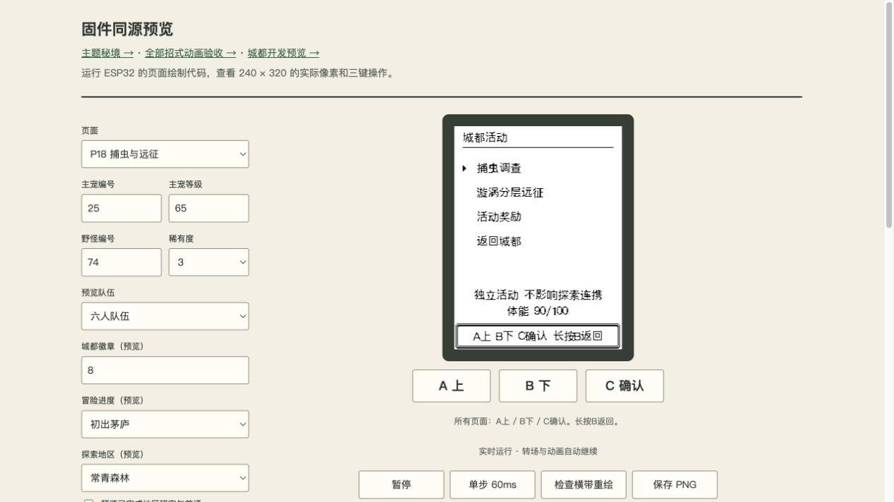
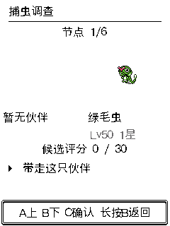
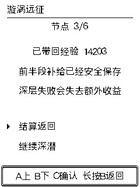
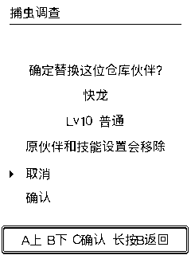

# 城都批次 B：捕虫调查与漩涡分层远征

2026-10-17 开发验收记录。本批已实现，可在本地同源预览体验；未烧录、未提交发布、未更新线上服务。批次 C～E 的救助、遗迹、传说演出与终章仍在后续计划中。

入口：城都之旅 → 特色活动。后台新增 P18，支持设置城都徽章数；[直接体验](http://127.0.0.1:8766/firmware.html?johto_badges=8&level=65#P18)。后台运行生产 C 页面、活动状态机和事务计算；宿主适配器替代硬件/NVS，不等同真机验收。

## 捕虫调查

- 两枚城都徽章开放；选择自己的一只伙伴，确认出发后消耗 10 体能。6 个节点、最多 3 次投球，消耗背包中实际选择的球。取消出发不扣体能。
- 草丛、树干、花丛各有不同物种池，合计 15 种第一/第二世代虫系主题伙伴。等级限制 35～50，物种与闪光结果生成后保存；闪光使用普通探索渠道 1/48，不叠加探索连携。
- 最终可带走一只候选。比较物种、等级、闪光和候选评分；默认保留原候选，替换闪光另行确认。提前结算可保留候选及已达评分奖励。
- 评分＝观察种类×10＋捕获候选基础 20＋候选稀有度×10；闪光不额外加分。铜/银/金门槛 20/50/90。首次银档给太阳之石，重复完成三局有效调查可选太阳之石或王者之证。有效调查要求完成 6 节点并观察至少 3 种。
- 按实际观察次数给予树果，4 节点以上给予哞哞牛奶，银/金档给予高级球。道具满额保留在活动奖励，可之后领取；不能空进空出刷三局奖励。
- 453 格仓库满时保留结算，手动选实际仓位并二次确认。取消、目标变化或保存失败不替换原伙伴，也不清候选。

## 漩涡分层远征

- 六枚城都徽章开放；选自己的三只伙伴，消耗 20 体能。采用各自技能开关，支持战斗中换宠。活动内 HP/异常独立，不能在外部换队、进化或改技能绕过局内约束。
- 入场锁定等级：普通基准 55～70、各层上限 75；挑战基准 70～85、各层上限 90。低等级会提示；局内获得经验不推高对手等级。
- 前两场战斗后到确定营地，选择回复存活伙伴或复苏。中继先将经验与补给原子结算，再决定返回或深入；“已带回”只在保存成功后显示。经验复用饱食加成与队伍追赶规则。
- 深层可选水域或钢铁精英；钢铁对手额外提高 2 级，受该难度上限约束。再战斗、恢复、迎战守护者。深层战败/认输丢失尚未带回的收益，保留中继已存经验和道具；普通探索连携不受影响。
- 通关奖励龙之鳞片，钢铁支路另给金属膜，附恢复补给；水系目标伙伴加入遭遇列表，按秘境渠道 1/16 锁定闪光。海渊首通成就接入实际通关记录。银色之羽记为持久化剧情凭据，后续洛奇亚演出仍归批次 C，未宣称本批完成其新剧情。
- 捕虫和远征都可暂停、返回和重启后继续；随机结果、投球次数、战斗状态、待领奖励均保存，不通过重进页面重抽或重复领奖。

## 存档和资源

逻辑 V27 在冻结的 22,424 字节 V26 前缀后追加 1,056 字节活动记录，总计 23,480 字节。V5～V26 原始样本保持不变，追加 V27 固定样本；旧格式迁移后新活动为未开始，旧收集、队伍、技能、道具、成就和篇章保留。未改分区、旧秘境结构、物品编号或 V24 以来的 56 KiB USB 容器。新格式不能倒灌到不支持它的旧固件。

事务使用原保存锁及共享世界工作区；没有新增完整世界记录的临时堆/栈副本。候选替换、新伙伴、图鉴、体能、奖励和领取凭据同次提交。失败后下一次事务重新收集运行态；拒绝的事务不污染下一次正常保存。

本次目标应用 3,029,136 字节（约 2.89 MiB），factory 分区剩余 378,736 字节（约 370 KiB），仍处于既有 8 MiB Flash 布局内。应用较批次 A 增加 21,392 字节。构建提示的 1 MiB recovery 分区不能容纳主游戏是既有布局；主游戏只用于 factory，不能将此构建写到 recovery。

[资源记录](evidence/johto-activities-2026-10-17/resources.json)：DRAM data 14,036、BSS 172,128 字节；RTC 工作区 7,792、RTC 总使用 7,864、余 328 字节；IRAM 78,848 字节。新增模块目标最大单函数栈帧：活动核心 112、事务 176、页面 272 字节。静态数字不是运行时最小堆、最大连续堆和任务栈余量的证明。

## 验证

[检查清单](evidence/johto-activities-2026-10-17/checks.json) 共 21 项通过，包括构建、AGENTS 全套 USB/存档/更新/地区/栈检查及城都、进化、训练家关联回归。

- `verify_johto_activity.py`：真实 world/save/bank 事务；V5～V27 迁移；两/六徽章门槛、体能回滚、6 节点/3 球、候选重启保持、459 个体满仓、452 物理索引替换、过期目标/写失败、满包延后领取、每三局奖励、无效状态拒绝、普通下限和高等级上限、真实战败、中继/深层/撤退、重启不重发、探索连携独立。
- `verify_johto_activity_ui.py`：166 次生产页面输入及完整横带重绘检查，含出发取消、写失败重试、投球动画、候选比较、暂停继续、提前结算、满仓取消/二次确认、换宠、营地、中继、两段远征通关和认输结算。修复认输跳转后旧战斗页再次绘制导致的错误帧。
- `verify_nvs_restore_roundtrip.py`：真实 ESP-IDF NVS 引擎在隔离 RAM Flash 上运行；459 个体、稠密不同技能策略、进行中远征、各类待领奖励及共享 Wi-Fi/PHY/其他命名空间；300 次连续保存、GC、重挂载、导出/覆盖/重启恢复与故障中断检查。未触碰玩家唯一存档。
- 浏览器实际载入 P18，徽章参数可用，横带重绘 0 像素差异。新页面与固件共用 C 渲染和状态逻辑。

本批未测：设备 Wi-Fi 运行后的最小可用堆、最大连续块、任务栈水位；USB 真机设置变化→导入覆盖恢复；实际按键、音量与长时游玩平衡。未运行远端 CI。发布前必须补齐并明确区分隔离验证与真机结果。公开玩家体验需升级固件；仅刷新网页不会增加设备玩法。未来正式发布时仍需随城都大版本同步新版在线/离线备份工具，沿用更新前备份和完整安装后的恢复路径。

基于源码提交 `67a4a25749463d50750c9448ff9d5217d1379094` 的当前开发工作区；应用 SHA-256：`e1924afc7030cc3e2b96be04dd951fd57fabc1526c2ace85d9814b5681ea54fa`。本批未生成社区发布包，未把开发编译产物标记成已发布版本。对应文件摘要另存 [源码摘要](evidence/johto-activities-2026-10-17/source-sha256.json)。

QualityGate 本地 gate/raw_gate 均 pass，0 阻断，execution_complete=true，incomplete_engines 为空，无修复轮次。Mutation 默认暂停，本次工具状态 not_applicable，未作为覆盖证明；fast feedback 因无匹配脚本且范围超过阈值跳过。准备阶段返回的适用规则只匹配四份 JSON 元数据；最终中央任务状态 completed、0 findings，当前 fingerprint `qgcf_88e3760dc21c471757d3db7fe0e7993731d829b12eec15144bc66b93cf527dc2` 已核对并消费，未进行语义自动修复。此结论不代替 C 行为或真机验收，结果摘要另附 [语义记录](evidence/johto-activities-2026-10-17/qualitygate-semantic.json)。

