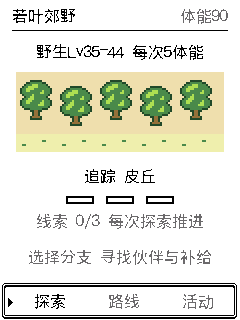
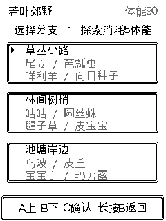

# 城都路线交互改造与验证

后续进展：已完成真机保档烧录，并修正实测发现的调试线程栈余量问题；最终固件摘要、路线验收、V29/V30 导入覆盖和资源数据见 [真机验收记录](johto-routes-device-2026-10-18.md)。下文保留改造完成、尚未烧录时的构建记录。

2026-10-18。在已有城都 V30 开发改动基础上完成，本轮未提交、未烧录、未发布。源代码基点 `67a4a25749463d50750c9448ff9d5217d1379094`，工作区包含此前各批未提交改动；不能把 HEAD 直接标为本构建的源码。关键文件摘要见 [source-hashes.json](evidence/johto-routes-2026-10-18/source-hashes.json)。

## 行为变化

- 普通进入城都取消原 16 帧（定时器名义 800 ms，实际还受 LCD 绘制耗时影响）的淡入和按键锁定；入场即可操作。初始伙伴等短过渡保留 4 帧，可按键继续；蛋孵化演出保留。未宣称真机实测延迟。
- “调查路线”先进入路线详情，显示等级范围、体能、追踪目标与三格线索；选地图不扣资源。八图各有三分支，明确显示四种常规伙伴，分支决定随机遭遇池。
- 每次确认探索扣 5 体能。前三次各积累一条线索，同时按 60% 遭遇 / 40% 足迹补给分流；第四次必定发现显示的目标，然后轮换。线索直接由既有调查次数推导，退出或重启不重新抽取。计数饱和时的总次数回退规则见设计文档。
- 足迹补给包含树果、牛奶、超级球、开心饼干；满堆沿用现有基础补给替换规则，全部满额明确提示。研究奖励、孵蛋、故事调查与探索连携继续生效，未知图腾和传说等专属获取不进入普通池。
- “查看”直接打开当前遭遇，捕获／战斗／逃跑使用共同返回路径，回到原路线；“继续”保留上次分支。过期 UID 不会误开另一只伙伴。遭遇仍最多 5 条，满额会提示替换最早一条。活动入口可进入研究奖励、特色活动与冒险笔记。

## 存档与资源边界

没有增加或复用持久化字段：仍为 V30、39,912 字节世界记录、753 格仓库、格式 4 的 72 KiB 备份和原分区。所有历史 V5～V30 固定样本按原字节参与校验；不覆盖旧样本。旧调查次数仍表示付费调查次数，既有研究领奖状态不变；前三格线索按旧次数计算。

共享生成器只修改受锁保护的事务候选；体能、队列、图鉴、背包、调查与故事进度保存成功后才发布。保存失败保留运行态，下一次普通保存重新收集，不能漏写被拒绝的候选。设备与宿主预览共用该生成器。网页／离线工具及 USB 协议本轮未改；未部署 Pages/devbox。使用本轮玩法需要新固件，本地预览刷新即可；由旧公开版升级到城都版仍按已有要求更新备份工具。

没有新增固件大块临时堆或第二份世界工作区。目标编译栈：`johto_routes` 最大 144 B、`play_johto` 160 B、`world` 432 B。RTC 编解码区 7,792 B，RTC 总占用 7,864 B / 剩余 328 B；IRAM 78,848 B，低于 81,920 B 门槛。**这些是静态结果，不代替本版真机 Wi-Fi 后堆余量、最大连续块和 USB 设置变化→导入覆盖验收。**

## 验证结果

- 新增 `verify_johto_routes.py`：12,000 次种子模拟，24 分支均覆盖全部候选；验证地图等级上下限、线索与目标轮换、特殊物种排除、队列上限、满补给、体能/计数边界、保存失败、事务候选不污染、重启保留。ASan/UBSan 使用 `-fno-sanitize-recover=all`，通过。
- 新增 `verify_johto_routes_ui.py`：281 次原生固件 UI/输入检查，20 行条带与全帧重绘一致；覆盖即时按键、取消不扣体能、保存失败重试、8 图与 24 分支、直接遭遇、逃跑返回原路线、连续探索、后台淘汰后安全提示。最终预览构建 `c592e240060b57d01a6d`。
- AGENTS 的 USB、导入、历史样本、存储、网页、备份 checkpoint、分发、更新包、真实 NVS、地区与城都各批回归通过；本轮批次 26 项退出码均为 0，另有目标存档栈、秘境栈和最终 UI 复测通过。真实 NVS 是隔离宿主引擎，不是真机。
- 双银行检查包含 1,218 处完整／部分 I/O 故障与 500 次替换；历史迁移 V5～V30、损坏／未知版本拒绝、备份导入等见对应日志。
- `tools/device/fw.sh build` 成功。主应用 **3,135,472 B**，factory 容量 3,407,872 B，剩余 **272,400 B**，分区仍在 8 MiB 内。SHA-256：`f8d7992671991017d04b93312f5507ecff6f0304bdabffa083693041bc8da21b`。IDF 同时提示主应用大于独立 recovery 分区，该分区运行自己的恢复程序，本轮未改用途或写入它。
- 本地 inspector 已重启；HTTP 4 帧请求经 `check` 完整重绘比较均为 0 差异，返回最终预览构建。未执行硬件烧录或真实页面计时。
- `git diff --check` 通过。QualityGate 本地 `gate=pass` / `raw_gate=pass` / `block_merge=false` / `execution_complete=true`，`mutation_status=not_applicable`，工具报告 `quality_confidence=full`、无 incomplete engines；修复轮数与 actionable block 均为 0。语义结果当前指纹 `completed/no_targets`，没有适用 C 规则、未执行模型审查，不能把空 findings 当作独立审查通过。未新增豁免；本轮编译缩进错误与测试夹具错误已修复并复测。

[检查列表](evidence/johto-routes-2026-10-18/checks.json) · [目标栈检查](evidence/johto-routes-2026-10-18/target-checks.json) · [最终 UI 检查](evidence/johto-routes-2026-10-18/ui.json) · [HTTP 检查](evidence/johto-routes-2026-10-18/http.json) · [QualityGate](evidence/johto-routes-2026-10-18/qualitygate.json)

